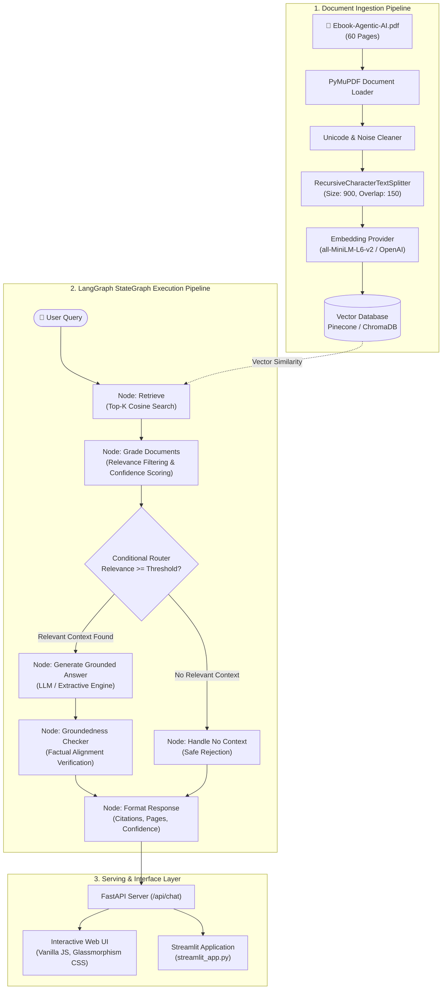

# 🏗️ System Architecture: Agentic AI eBook RAG Chatbot

This document provides a technical overview of the Retrieval-Augmented Generation (RAG) system built with **LangGraph**, **Pinecone / ChromaDB**, **Sentence Transformers / OpenAI**, and **FastAPI**.

---

## 1. High-Level System Architecture

The following diagram illustrates the end-to-end data flow from document ingestion to query execution:



---

## 2. Component Breakdown

### A. Document Ingestion & Chunking (`src/pdf_loader.py` & `ingest.py`)
- **PDF Extraction**: Uses `PyMuPDF` (`fitz`) to extract clean text while retaining 1-indexed page numbers.
- **Section & Chapter Detection**: Scans page headers against known chapter headings (e.g., *Terminology Maze*, *Multi-Agent Systems*, *Orchestration*, *Readiness Framework*) and attaches chapter metadata to each chunk.
- **Recursive Chunking**: Splits text using `langchain_text_splitters.RecursiveCharacterTextSplitter` with separators `["\n\n", "\n", ". ", "; ", " "]`, targeting `900` characters with `150` characters of contextual overlap.
- **Output**: 123 distinct, semantically cohesive chunks across all 60 pages of the eBook.

### B. Embedding & Vector Database Layer (`src/embeddings.py` & `src/vectorstore.py`)
- **Embedding Factory**:
  - **HuggingFace** (`all-MiniLM-L6-v2`): 384-dimensional normalized vectors, fast CPU inference, zero cost.
  - **OpenAI** (`text-embedding-3-small`): 1536-dimensional vectors for cloud deployments.
  - **Google Gemini** (`models/text-embedding-004`): 768-dimensional vectors.
- **Unified Vector Store**:
  - **Pinecone**: Cloud vector index configured with `ServerlessSpec(cloud="aws", region="us-east-1")` and `cosine` distance metric. Automatically creates the index if not present and performs batch upserts with metadata (`text`, `page`, `chapter`, `source`).
  - **ChromaDB**: Local persistent vector store (`chromadb.PersistentClient`) with cosine similarity space, allowing offline execution without cloud API keys.

---

## 3. LangGraph RAG StateGraph (`src/rag_graph.py`)

The conversational intelligence is modeled as a state machine using `langgraph.graph.StateGraph`.

### The `RAGState` Structure
```python
class RAGState(TypedDict):
    question: str
    chat_history: List[Dict[str, str]]
    query_vector: List[float]
    retrieved_docs: List[Dict[str, Any]]
    graded_docs: List[Dict[str, Any]]
    answer: str
    confidence_score: float
    confidence_level: str  # HIGH, MEDIUM, LOW
    is_grounded: bool
    sources: List[Dict[str, Any]]
```

### StateGraph Nodes & Transitions

1. **`retrieve`**: Converts the question into an embedding vector and searches the vector store for the top $K$ ($K=5$) nearest context chunks.
2. **`grade_documents`**:
   - Inspects the similarity score of each retrieved document against `MIN_RELEVANCE_SCORE` (default `0.25`).
   - Filters out non-relevant chunks.
   - Computes an aggregate **Confidence Score**:
     $$\text{Confidence} = 0.6 \times \text{Score}_{\text{top1}} + 0.4 \times \overline{\text{Score}}_{\text{top3}}$$
   - Categorizes confidence:
     - `HIGH`: $\ge 0.70$
     - `MEDIUM`: $0.45 \le \text{Score} < 0.70$
     - `LOW`: $< 0.45$
3. **`_router_decision` (Conditional Edge)**:
   - If `graded_docs` is empty $\rightarrow$ route to `handle_no_context`.
   - If `graded_docs` contains relevant chunks $\rightarrow$ route to `generate`.
4. **`handle_no_context`**:
   - Immediately returns: *"I am sorry, but the provided Agentic AI eBook does not contain sufficient information to answer this question."*
   - Sets `confidence_score = 0.0`, `confidence_level = "LOW"`, `is_grounded = True`.
5. **`generate`**:
   - Compiles retrieved excerpts into an annotated context block formatted with `[Excerpt i | Page P | Section: S]`.
   - Enforces strict grounding rules in the system prompt: no hallucination, no external world knowledge, factual fidelity to the text.
   - Invokes configured LLM (`ChatOpenAI`, `ChatGoogleGenerativeAI`, `ChatGroq`) or `LocalExtractiveLLM`.
6. **`groundedness_checker`**:
   - Computes the lexical and semantic overlap between the generated answer and the source chunks.
   - Verifies whether all key entities and terms originate within the retrieved context.
   - Flags answers with low groundedness ratios and adjusts confidence.
7. **`format_response`**:
   - Assembles final JSON response including deduplicated page sources, chunk previews, and confidence metrics.

---

## 4. Strict Grounding & Anti-Hallucination Design

To satisfy the requirement that **answers are strictly grounded in the PDF**:
1. **Low Temperature**: LLMs are initialized with `temperature=0.0` to minimize randomness.
2. **Constrained System Instructions**: Explicitly forbids extrapolation and instructs the model to refuse queries outside the provided context.
3. **Relevance Gating**: Queries with cosine similarity below threshold do not proceed to generation, preventing the model from confabulating answers to unrelated prompts.
4. **Groundedness Verifier Node**: Post-generation check that verifies factual overlap between context and output.

---

## 5. API Response Specification

`POST /api/chat` returns:

```json
{
  "question": "What is Agentic AI and how does it differ from traditional LLMs?",
  "final_answer": "Based on the Agentic AI eBook, while LLMs are powerful tools for processing and generating human-like text, agents are goal-driven systems capable of performing actions autonomously in a dynamic environment...",
  "confidence_score": 0.747,
  "confidence_level": "HIGH",
  "is_grounded": true,
  "retrieved_chunks": [
    {
      "chunk_id": "chunk_p10_1",
      "text": "The table below compares the key aspects of LLMs and agents...",
      "page": 10,
      "chapter": "The Terminology Maze",
      "relevance_score": 0.7436,
      "source": "Ebook-Agentic-AI.pdf"
    }
  ],
  "sources": [
    {
      "page": 10,
      "chapter": "The Terminology Maze",
      "score": 0.7436,
      "chunk_id": "chunk_p10_1"
    }
  ]
}
```
