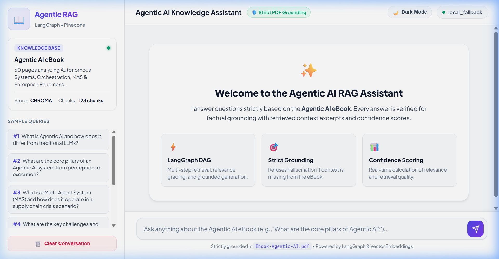
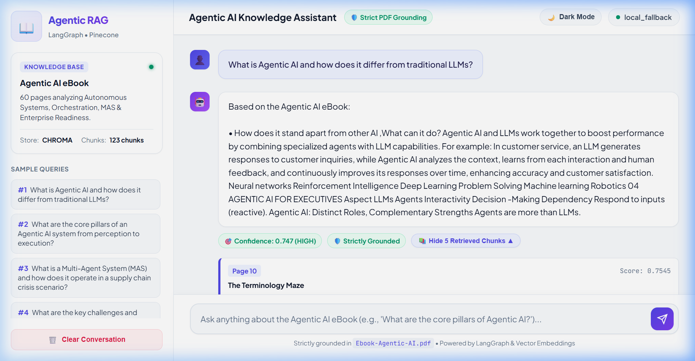

# 📖 Agentic AI eBook - RAG-Based AI Chatbot

A production-grade Retrieval-Augmented Generation (RAG) chatbot in Python powered by **LangGraph**, **Pinecone** (with automatic local **ChromaDB** fallback), **Sentence Transformers / OpenAI Embeddings**, and **FastAPI**.

Answers questions **strictly grounded** in the [Agentic AI eBook](Ebook-Agentic-AI.pdf) (*60 pages on Autonomous Systems, Multi-Agent Orchestration, and Enterprise Readiness*), returning:
- **Final grounded answer** with in-text page citations
- **Retrieved context chunks** with relevance scores, page numbers, and chapter metadata
- **Confidence score** (0.0 to 1.0) and level (`HIGH`, `MEDIUM`, `LOW`)
- **Strict anti-hallucination verification** (safely rejects out-of-domain questions)

---

## 🌟 Key Features

- **LangGraph StateGraph Workflow**: Declarative DAG with nodes for `retrieve` $\rightarrow$ `grade_documents` $\rightarrow$ `router` $\rightarrow$ `generate` $\rightarrow$ `groundedness_checker` $\rightarrow$ `format_response`.
- **Dual Vector Database Support**: Native **Pinecone v7** support for cloud vector indexes, plus local persistent **ChromaDB** for zero-cost offline execution.
- **Multi-Provider Embeddings**: Local HuggingFace (`all-MiniLM-L6-v2`), OpenAI (`text-embedding-3-small`), or Google Gemini (`text-embedding-004`).
- **Flexible LLM Support**: OpenAI (`gpt-4o-mini`), Google Gemini (`gemini-1.5-flash`), Groq (`llama-3.3-70b-versatile`), and an offline deterministic extractive fallback engine.
- **Strict Grounding Guarantee**: Gated relevance thresholding and post-generation groundedness checking prevent hallucinations.
- **Dual Interface**:
  - **FastAPI REST API**: Interactive Swagger docs at `http://localhost:8000/docs`.
  - **Modern Chat Web UI**: Glassmorphism frontend served directly by FastAPI at `http://localhost:8000/`.
  - **Streamlit App**: Interactive alternative at `streamlit run streamlit_app.py`.

---

## 📸 Screenshots & Web Interface (Light / White Theme)

### 1. Interactive Landing View
*Clean, modern white theme with sidebar displaying indexed knowledge chunks, vector database status, and quick-prompt pills:*



### 2. Grounded Answer with Retrieved Context Chunks & Confidence Scoring
*Real-time response execution showing strict grounding badge, confidence score (0.747 HIGH), and expandable retrieved chunks drawer with page numbers and relevance scores:*



---

## 📁 Repository Structure

```
.
├── Ebook-Agentic-AI.pdf        # Target Knowledge Base (60 pages)
├── README.md                   # Setup instructions and usage guide
├── ARCHITECTURE.md             # Detailed LangGraph DAG and architectural design
├── requirements.txt            # Python dependencies
├── .env.example                # Environment variable template
├── sample_queries.json         # Curated benchmark queries with expected chapters
├── ingest.py                   # PDF extraction, chunking, and embedding ingestion
├── api.py                      # FastAPI server & static web host
├── streamlit_app.py            # Streamlit Chat interface
├── test_rag.py                 # Automated evaluation suite
├── src/
│   ├── __init__.py
│   ├── config.py               # Settings and environment loader
│   ├── pdf_loader.py           # PyMuPDF extractor and recursive chunker
│   ├── embeddings.py           # Multi-provider embedding factory
│   ├── vectorstore.py          # Unified Pinecone & ChromaDB manager
│   ├── llm.py                  # LLM factory (OpenAI, Gemini, Groq, Fallback)
│   └── rag_graph.py            # LangGraph StateGraph implementation
└── web/
    ├── index.html              # Responsive glassmorphism chat UI
    ├── styles.css              # Custom dark-theme styling
    └── app.js                  # Frontend state, API integration, chunk viewer
```

---

## 🚀 Quickstart & Setup Instructions

### 1. Prerequisites
- Python 3.10+ (tested on Python 3.13)
- `pip` package manager

### 2. Clone the Repository
```bash
git clone https://github.com/<your-username>/rag-agentic-ai-chatbot.git
cd rag-agentic-ai-chatbot
```

### 3. Create and Activate Virtual Environment
```bash
# Windows
python -m venv venv
.\venv\Scripts\activate

# Linux / macOS
python3 -m venv venv
source venv/bin/activate
```

### 4. Install Dependencies
```bash
pip install -r requirements.txt
```

### 5. Configure Environment Variables
Copy `.env.example` to `.env`:
```bash
cp .env.example .env
```
Edit `.env` to configure your keys:
- **To use Pinecone**: Set `PINECONE_API_KEY=your_key` and `PINECONE_INDEX_NAME=agentic-ai-ebook`.
- **To use Local ChromaDB** (No cloud keys needed): Leave `VECTOR_DB_TYPE=chroma` or `auto`.
- **To use an LLM**: Set `OPENAI_API_KEY`, `GEMINI_API_KEY`, or `GROQ_API_KEY`. (If none are set, the app seamlessly runs using the local deterministic extractive engine).

---

## 📥 Ingesting the eBook

Run the ingestion script to parse the PDF, split it into semantic chunks, generate vector embeddings, and store them into your vector store:

```bash
python ingest.py --force
```

**Ingestion Output:**
```
============================================================
📖 Starting Agentic AI eBook Ingestion Pipeline
Target PDF: Ebook-Agentic-AI.pdf
Vector DB: CHROMA / PINECONE
Embedding Provider: huggingface (all-MiniLM-L6-v2)
============================================================
[1/4] Parsing PDF & generating semantic chunks...
✓ Extracted 123 chunks across 60 pages.
[2/4] Initializing embeddings...
✓ Embedding model ready. Vector dimension: 384
[3/4] Connecting to Vector Store...
[4/4] Generating embeddings & storing vectors...
🎉 Ingestion Completed Successfully!
✓ Total Chunks Processed: 123
✓ Vectors Stored: 123
```

---

## 💬 Running the Chatbot

### Option A: FastAPI Server + Interactive Web UI (Recommended)
Start the FastAPI server:
```bash
python api.py
# or using uvicorn directly:
uvicorn api:app --host 0.0.0.0 --port 8000 --reload
```
Open your browser at:
- **Interactive Chat Web UI**: `http://localhost:8000/`
- **Swagger API Docs**: `http://localhost:8000/docs`

### Option B: Streamlit Web Application
Run the Streamlit app:
```bash
streamlit run streamlit_app.py
```
This opens `http://localhost:8501/` with a sidebar for vector status and chunk inspection drawers.

---

## 🧪 Automated Testing & Evaluation

Run the automated evaluation suite to test the LangGraph RAG pipeline against the curated benchmark queries:

```bash
python test_rag.py
```

### Evaluation Benchmark Results
| ID | Status | Confidence | Retrieved Pages | Sample Query |
|---|---|---|---|---|
| **#1** | **PASSED** | 0.747 (HIGH) | `[9, 10]` | What is Agentic AI and how does it differ from traditional LLMs? |
| **#2** | **PASSED** | 0.760 (HIGH) | `[19, 20, 21]` | What are the core pillars of an Agentic AI system from perception to execution? |
| **#3** | **PASSED** | 0.766 (HIGH) | `[30, 31, 33, 34]` | What is a Multi-Agent System (MAS) and how does it operate in a supply chain crisis? |
| **#4** | **PASSED** | 0.791 (HIGH) | `[38, 39, 40]` | What are the key challenges and mitigation strategies when orchestrating MAS? |
| **#5** | **PASSED** | 0.810 (HIGH) | `[48, 50, 51]` | What are the essential steps an organization should take to assess readiness? |
| **#6** | **PASSED** | 0.786 (HIGH) | `[54, 55, 58]` | How is Agentic AI practically applied in manufacturing and retail? |
| **#7** | **PASSED** | 0.000 (LOW) | Safe Rejection | *Negative Test:* Who won the 2022 FIFA World Cup in Qatar? |

*Notice that Query #7 correctly refuses to hallucinate and reports that the eBook does not contain the answer with 0.0 confidence.*

---

## 🔌 API Endpoints Reference

### `POST /api/chat`
Ask a question grounded in the Agentic AI eBook.

**Request Body:**
```json
{
  "question": "What is the difference between LLMs and AI Agents?"
}
```

**Response Body:**
```json
{
  "question": "What is the difference between LLMs and AI Agents?",
  "final_answer": "Based on the Agentic AI eBook: While LLMs are powerful tools for processing and generating human-like text, agents are goal-driven systems capable of performing actions autonomously in a dynamic environment...",
  "confidence_score": 0.747,
  "confidence_level": "HIGH",
  "is_grounded": true,
  "retrieved_chunks": [
    {
      "chunk_id": "chunk_p10_1",
      "text": "The table below compares the key aspects of LLMs and agents...",
      "page": 10,
      "chapter": "The Terminology Maze",
      "relevance_score": 0.7436,
      "source": "Ebook-Agentic-AI.pdf"
    }
  ],
  "sources": [
    {
      "page": 10,
      "chapter": "The Terminology Maze",
      "score": 0.7436,
      "chunk_id": "chunk_p10_1"
    }
  ]
}
```

### Other Endpoints
- `GET /api/sample-queries`: Returns list of 6+ curated sample queries.
- `GET /api/health`: Vector DB connectivity, total chunks indexed, and active model providers.
- `POST /api/ingest`: Triggers on-demand re-ingestion of the PDF.

---

## 🏛️ Architecture Explanation

See [ARCHITECTURE.md](ARCHITECTURE.md) for detailed diagrams, LangGraph StateGraph transitions, anti-hallucination gating algorithms, and confidence scoring equations.
